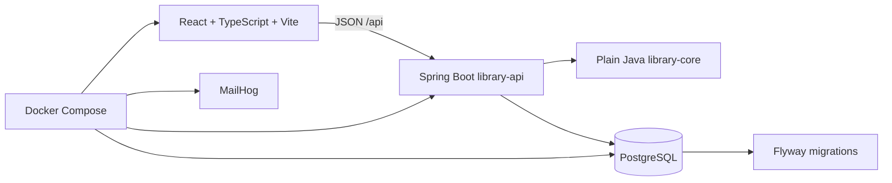
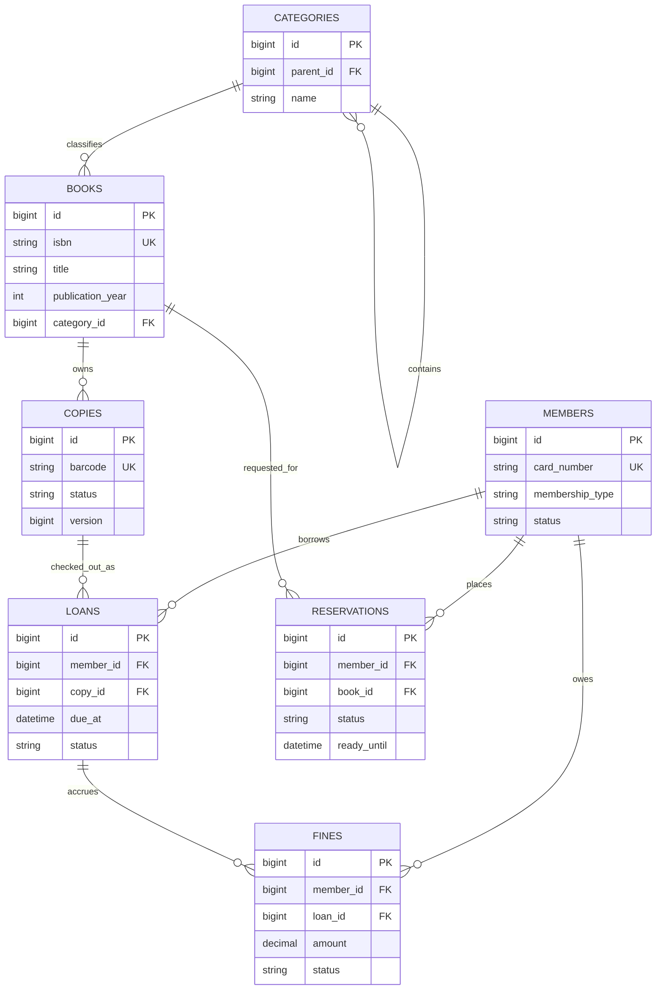
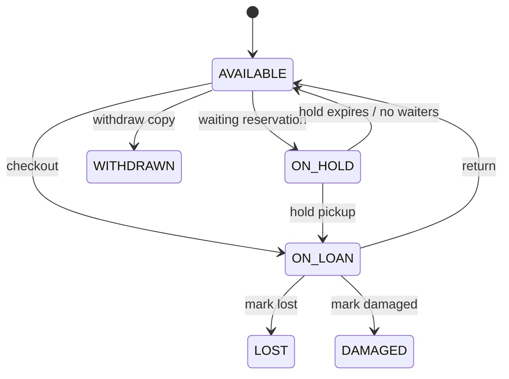
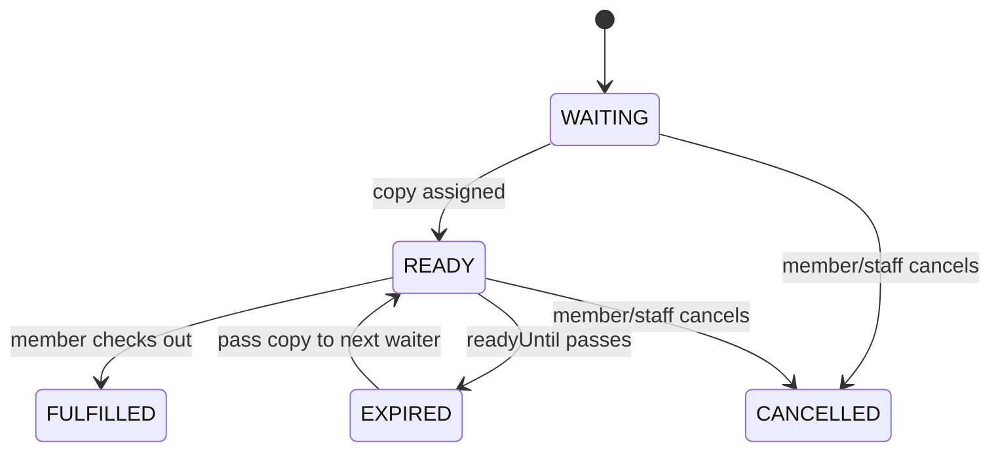

# LibraDesk

LibraDesk is a library-management portfolio monorepo. The project pairs a Spring Boot/PostgreSQL API foundation with a standalone Java 17 data-structures module and a responsive React catalog experience. The catalog UI currently runs on generated demo records in mock mode; the schema and API bootstrap are ready for continued domain/API implementation.

> Demo project with synthetic data.

## Screenshots

Add screenshots here after running the frontend:

- `docs/screenshots/discover.png` — catalog home
- `docs/screenshots/lab.png` — Chemistry Lab

## Architecture



## Data model



## Data structures in `library-core`

| Structure | Use | Time | Space |
|---|---|---:|---:|
| Chained `HashTable` | ISBN/member/barcode lookups, internal maps | expected O(1) get/put/remove | O(n + buckets) |
| `Trie` | Case-normalized title/author prefix suggestions | insert/prefix O(m); bounded top-k O(s log k + k²) | O(total characters + k) |
| `InvertedWordIndex` | AND search with sorted postings | O(sum posting lengths) | O(total postings) |
| `AvlTree` | Sorted catalog keys and range access | O(log n) update; range O(log n + r); in-order page O(n) | O(n) |
| Stable `MergeSort` | Stable catalog ordering | O(n log n) | O(n) |
| Median-of-three `QuickSort` | In-memory report arrays | expected O(n log n), worst O(n²) | expected O(log n) stack |
| `BinarySearch` | Exact and lower-bound lookup | O(log n) | O(1) |
| `IndexedMinHeap` | Waitlist/overdue priority queues | O(log n) insert/update/remove | O(n) |
| `CircularQueue`, `Stack` | Batch work and return undo history | amortized O(1) | O(n) |
| `LruCache` | Recent/search result cache | expected O(1) get/put/remove | O(capacity) |
| `CategoryTree` | Category paths and subtree counts | path O(height); count O(subtree) | O(categories) |

`CatalogIndex` is a small in-memory facade over the implemented lookup, suggestion, postings, ordering and stable sort structures. `LoanPolicy`, `FineCalculator` and `WaitlistManager` are pure core algorithms; the API does not yet wire those rules into persisted circulation endpoints.

## Circulation and hold states





## Fine formula

`fine = min(book price, daily rate × chargeable overdue days)` where chargeable days begin after the one-day grace window and configured closed dates are skipped. Example: a ₹450 book returned four days after its due date, ₹2/day, one grace day, no holidays: three chargeable days × ₹2 = **₹6**. The calculation is implemented in `FineCalculator` and accepts a set of closed dates.

## Run locally

Requirements: Java 17+, Maven 3.9+, Node 20+, and Docker Compose v2.

```powershell
Copy-Item .env.example .env
docker compose up --build
```

- Frontend: <http://localhost:3000>
- API health: <http://localhost:8080/actuator/health>
- MailHog: <http://localhost:8025>
- PostgreSQL: localhost:5432

To run the Vite UI in mock mode without a backend, copy `frontend/.env.example` to `frontend/.env`, then run `npm install` and `npm run dev` in `frontend`. Set `VITE_USE_MOCK=false` to use the API.

The Flyway migration creates the relational schema. Synthetic starter catalog rows and copies are in `backend/seed.sql`; execute it against the local database with `psql -h localhost -U libradesk -d libradesk -f backend/seed.sql` when using the `psql` client.

## Tests and benchmarks

Run core and API tests with `mvn test` from the repository root. Run frontend tests/build with `npm test` and `npm run build` from `frontend`. CI runs both and builds the API image.

`CoreRandomizedTest` compares hash table, AVL tree, indexed heap, and merge sort behavior against JDK baselines; hash/AVL/heap exercise 100,000 seeded operations. `BusinessAlgorithmsTest` covers fine boundaries, loan rules, waitlist ordering, and index intersection. A React Testing Library test covers live suggestion selection. Local verification in the authoring environment was limited: Java 21 compiled all `library-core` production sources with `javac --release 17`; Maven, Docker, and installed npm dependencies were unavailable, so Maven/React tests and Docker startup could not be executed here.

| Benchmark | Result |
|---|---|
| MergeSort, 100,000 random integers | 119.981 ms |
| QuickSort, 100,000 random integers | 56.379 ms |
| `Arrays.sort`, 100,000 random integers | 87.647 ms |
| Linear scan / `Arrays.binarySearch`, 100,000 items | 1.668 ms / 0.030 ms |
| Trie vs SQL `ILIKE` | Requires the planned API comparison endpoint and seeded 100k catalog |

Sort and lookup numbers are one un-warmed local run under Java 21 on the authoring machine; they are indicative only. Re-run with `mvn -pl backend/library-core package` followed by `java -cp backend/library-core/target/classes com.libradesk.core.SortBenchmark 200000` for measurements on your hardware. Trie/SQL comparison remains follow-up work.

## API summary

Implemented demo endpoints: `GET /api/books/search?q=` (supports category/availability filters and `explain=true`), `GET /api/books/suggest?prefix=&type=`, `GET /api/books/{id}`, `GET /api/books/isbn/{isbn}`, `GET /api/lab/search-compare?q=`, `GET /api/lab/structure-stats`, and Spring Actuator health. The Spring API builds its synthetic in-memory catalog through `CatalogIndex`; SQL ILIKE is explicitly called out as unavailable in the lab response. See [api-examples.http](api-examples.http). Flyway defines tables for books, copies, members, loans, holds, fines, audit, notifications, digital access, and categories. The broader auth, staff circulation, reports, administration, write-through indexing, scheduling, and role enforcement described in the original project brief remain to be implemented before this can serve as a production library system.

## Design decisions

- **Write-through index consistency:** the intended API boundary is to update the in-memory catalog only after a database transaction commits; this repository includes the core index facade but not yet the transaction listener/rebuild integration.
- **Indexed heap:** keyed updates/removals avoid stale waitlist entries and keep reservation priority changes at O(log n).
- **AVL over plain BST:** self-balancing guarantees logarithmic catalog access even for already-sorted insertions.
- **Synthetic-only records:** all bundled catalog rows and UI demo data are generated examples.
- **Physical-first discovery:** catalog cards show current availability and shelf codes; each book detail includes floor, collection wing, aisle, and shelf directions.

## Current demo walkthrough

1. Start the stack with `docker compose up --build`.
2. Search for `algorithm` on Discover; try the category chips and title sort.
3. Open **Chemistry Lab** to explore the selected periodic table and calculate molar mass or solution molarity.
4. Call `GET /api/books/search?q=algorithm&explain=true` to see the structures and elapsed microseconds in the paginated response.

The requested 100,000-book generator and last-copy/hold/return workflow are not yet wired into API services. The seed SQL currently contains twelve synthetic books and sixteen physical copies with shelf codes, and the broader circulation demo needs the persistence and role-protected endpoints listed above.

Catalog cards include a session-demo borrow flow. It asks for borrower name, mobile number, and duration, calculates an estimate at ₹5/day, and adds the loan to **Borrowed books**. No payment is collected and borrower details remain in app memory for the current session.

## Demo accounts

No login endpoint or credential-bearing demo accounts have been added yet. Current UI identity is a non-authenticated display placeholder; synthetic DB seed records are catalog-only.
